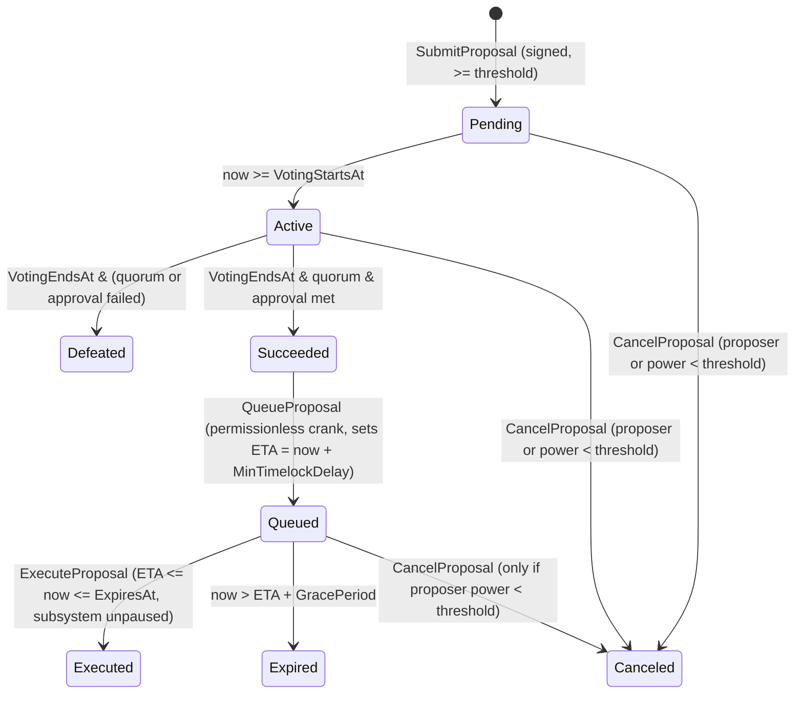

# HIP-1352: Open Protocol Governance, Treasury & Sovereign Forkability

**Issue**: `hanzoai/cloud#19` (`p1`, `bounty`, `decentralized`, `governance`, `hip-1352`)  
**Packages**: `apps/governance`, `cmd/governance-bench`, mounted in `apps/apps.go` (`apps.Wire()`)  
**Raw Measured Results**: [`results.json`](./results.json)  
**License**: `Apache-2.0 OR MIT`

---

## 1. References & License Audit

| Reference / Dependency | License | Scope & Clean-Room Usage |
|---|---|---|
| OpenZeppelin Governor (`GovernorCountingSimple`, `ERC20Votes`, `TimelockController`) | MIT | Clean-room Go implementation of snapshot-locked voting power, `For + Abstain` quorum, `Pending -> Active -> (Defeated \| Succeeded) -> Queued -> (Executed \| Canceled \| Expired)` state machine, mandatory `MinTimelockDelay` + `GracePeriod`, and proposer-threshold cancellation semantics. |
| Zoo DAO Operating System (`zoo-apps/papers#2`) | Open Research / Apache-2.0 / MIT | Governance architecture for multi-party protocol parameter registries, public-goods treasury caps, bounded emergency safeguards, and sovereign community forkability without permanent admin overrides. |
| Go Standard Library (`crypto/ed25519`, `crypto/sha256`, `math/big`, `encoding/json`) | BSD-3-Clause | Zero-bloat Ed25519 signature verification, SHA-256 hash-chained JSONL ledger, overflow-safe quorum/approval math. |
| `github.com/zap-proto/zip` & `github.com/luxfi/log` (already pinned in `go.mod`) | Apache-2.0 / MIT | Canonical Hanzo Cloud typed HTTP/OpenAPI/MCP router (`Mount`) and scoped structured logging. **Zero new dependencies added to `go.mod`.** |

### Explicit Proof / Attestation / Incentive Taxonomy
Per `hanzoai/cloud#19`, `apps/governance` never conflates cryptographic proofs, hardware attestations, and economic verification:
- `VerifierStandardPayload.Method` explicitly types every verifier profile as one of `cryptographic_proof`, `hardware_attestation`, `economic_incentive`, or `hybrid_deterministic`.
- Every `ModelRegistryEntry` requires an explicit `license_spdx` field (e.g., `Apache-2.0`, `MIT`) and a verified `verifier_profile_id`.
- Governance authenticity itself relies strictly on **cryptographic signatures** (domain-separated Ed25519) and **hash-chained audit logs** (SHA-256), never claiming hardware attestation or on-chain L1 finality inside the in-process Go engine.

---

## 2. Reproducible Baseline & Commands

All results in [`results.json`](./results.json) were generated on `linux/amd64` (`go1.27.1`, `2 vCPU`) with zero network calls and zero Hanzo-hosted services.

```bash
# 1. Static analysis (must exit 0 with zero warnings)
CGO_ENABLED=0 go vet ./apps/governance/... ./cmd/governance-bench/...

# 2. Full unit, security, HTTP caller-binding, fork replay & race-detector suite
go test -race -v ./apps/governance/...

# 3. Verify host-isolation invariant (apps/* never import github.com/hanzoai/cloud)
CGO_ENABLED=0 go test -v ./apps/...

# 4. Run reproducible multi-party DAO acceptance, 18-vector adversarial matrix,
#    fork-and-resume replay, and latency/throughput/memory benchmark
go run ./cmd/governance-bench -out docs/research/hip-1352-open-governance/results.json

# 5. Verify benchmark harness self-tests under -race
go test -race -v ./cmd/governance-bench/...

# 6. Verify full cloud binary builds cleanly with governance wired into apps.Wire()
CGO_ENABLED=0 go build ./cmd/cloud
```

---

## 3. Falsifiable Hypotheses & Negative / Failure Regimes

### Falsifiable Hypotheses
- **H1 (Zero Admin Override)**: No constructor option, parameter update, cancellation path, or emergency action can introduce a permanent Hanzo-admin bypass or weaken immutable safety floors (`MinQuorumBpsFloor`, `MinTimelockFloor`, `ApprovalThresholdBps >= 5001`).
- **H2 (Snapshot Flash-Loan & Quorum Defense)**: Post-snapshot voting-power transfers or delegations cannot alter voting weight on an already-created proposal, and `Against` votes cannot satisfy quorum (`For + Abstain >= ceil(TotalSupply * QuorumBps / 10000)`).
- **H3 (Bounded Emergency Safeguards)**: Emergency guardians can only trigger narrow, time-bounded pauses/circuit-breakers (`<= MaxEmergencyDuration <= 72h`) with mandatory cooldowns (`EmergencyCooldown`), automatic expiry, and DAO ratification/lift authority; guardians can never pause `"governance"` itself or disburse treasury funds.
- **H4 (Treasury Policy Enforcement)**: Treasury payouts require allowlisted recipients, non-zero timelock, single-disbursement caps, and cumulative per-epoch caps re-checked at execution time against live balances.
- **H5 (Sovereign Forkability & Replay Isolation)**: Exporting a signed `SovereignBundle` and importing it onto a new `ForkProtocolID` preserves 100% lossless state + hash-chained ledger integrity while cryptographically rejecting any cross-fork signature replay and detecting any single-byte tamper.

### Negative & Failure Regimes Tested (18/18 Rejected — 100.0%)
Every failure regime below is executed live by `cmd/governance-bench` and asserted in `apps/governance/governance_test.go`:
1. `admin_override_config`: `NewEngine` with `NoAdminOverride: false` -> `ErrAdminOverrideForbidden`.
2. `admin_override_proposal`: Proposal updating `hanzo_admin_override` -> `ErrAdminOverrideForbidden`.
3. `quorum_floor_violation`: Proposal lowering `quorum_bps` below `MinQuorumBpsFloor` -> `ErrProtocolInvariant`.
4. `zero_timelock_attack`: Proposal setting `min_timelock_delay_ms = 0` -> `ErrProtocolInvariant`.
5. `parameter_out_of_bounds`: Proposal setting `max_inference_fee_bps = 9999` (max `1000`) -> `ErrInvalidProposal`.
6. `flash_loan_post_snapshot_transfer`: Post-snapshot 400-power transfer attempting to vote on open proposal -> `ErrInsufficientPower`.
7. `double_vote_attack`: Same member casting a second ballot on the same proposal -> `ErrAlreadyVoted`.
8. `nonce_replay_attack`: Replaying a previously accepted signed ballot -> `ErrNonceReplay`.
9. `insufficient_quorum_queue`: Queueing a `Defeated` proposal below quorum -> `ErrInvalidState`.
10. `premature_timelock_execution`: Executing a `Queued` proposal before `ETA` -> `ErrTimelockNotReady`.
11. `emergency_treasury_drain`: Guardian invoking `drain_treasury` via emergency path -> `ErrEmergencyAbuse`.
12. `emergency_permanent_pause`: Guardian requesting `240h` pause (`> MaxEmergencyDuration`) -> `ErrEmergencyAbuse`.
13. `emergency_pause_governance`: Guardian attempting to pause `"governance"` -> `ErrEmergencyAbuse`.
14. `emergency_rolling_repause_cooldown`: Guardian re-pausing `"model_registry"` within `EmergencyCooldown` -> `ErrEmergencyCooldown`.
15. `treasury_unallowlisted_recipient`: Payout proposal to unallowlisted address -> `ErrTreasuryPolicy`.
16. `treasury_epoch_cap_exceeded`: Second payout pushing cumulative epoch spend over `TreasuryEpochCapMicroUSD` -> `ErrTreasuryPolicy` at execution time.
17. `tampered_sovereign_bundle`: Mutating `BalanceMicroUSD += 1` in exported bundle -> `ErrInvalidBundle` (`state_digest mismatch`).
18. `cross_fork_signature_replay`: Submitting parent-network signed proposal onto `hanzo-community-fork-1` -> `ErrInvalidSignature`.

### Declared Threat Model & Security Boundary
- **What this package guarantees**: Deterministic single-node / replicated state-machine enforcement, cryptographic authentication of every governance message, snapshot isolation, timelock/treasury/emergency invariants, authenticated HTTP caller binding, and verifiable sovereign export/forking.
- **What requires external review before real funds**: Per issue #19, before custodying real mainnet treasury assets, on-chain settlement / BFT consensus replication and smart-contract custody adapters require independent external security review. `apps/governance` provides the auditable off-chain/control-plane governance engine and replayable record format.

---

## 4. Bounded Canonical Integration Design

### Package & Composition Root Integration
- **`apps/governance`** strictly obeys `apps/imports_test.go`: imports only Go stdlib, `github.com/zap-proto/zip`, and `github.com/luxfi/log` — zero imports of `github.com/hanzoai/cloud` or sibling packages.
- **`apps/apps.go`** wires `{Name: "governance", Mount: governanceApp, OwnsHealth: true, ...}` in `apps.Wire()`, binding `principal.OrgFrom` and `principal.Acting` from the host identity boundary.
- **20 Typed `zip` Operations** under `/v1/governance` (projected simultaneously to REST, `/v1/openapi.json`, and `/mcp` with `zipdoc_gen.go` descriptions):
  - Read: `GET /health`, `/config`, `/parameters`, `/models`, `/verifiers`, `/treasury`, `/members`, `/proposals`, `/proposals/:id`, `/emergency`, `/ledger`, `/export` (fail-closed `503` when exporter key unconfigured).
  - Write (strict authenticated principal binding — caller/org come exclusively from verified context, never JSON body; all body fields carry `url:"-"` against query-string shadowing): `POST /proposals`, `/proposals/:id/votes`, `/proposals/:id/queue`, `/proposals/:id/execute`, `/proposals/:id/cancel`, `/delegations`, `/emergency`, `/fork/verify`.

### Proposal State Machine


### Cryptographic Domain Separation & Fork Procedure
Every signed message hashes a length-prefixed canonical preimage prefixed with `"hanzo.governance.hip1352.v1" || ProtocolID || MessageKind`:
1. **Export**: Any active member calls `ExportSovereignBundle(exporterID, privKey)` (or `GET /v1/governance/export` when configured), producing a canonical JSON `SovereignBundle` containing sorted state, complete hash-chained `AuditLedger`, `StateDigest`, `BundleHash`, and exporter Ed25519 signature.
2. **Verify**: Any third party runs `VerifySovereignBundle(bundle)` (or `POST /v1/governance/fork/verify`), re-checking `StateDigest`, `BundleHash`, full `VerifyLedger` chain, snapshot power-conservation roots, and every historical proposal, vote, and emergency signature.
3. **Fork**: Any independent community runs `ImportSovereignBundle(bundle, WithForkProtocolID("<new-network-id>"))`, binding `ParentProtocolID` and `ParentBundleHash`, appending a `fork_genesis` ledger entry, and domain-separating all future signatures to `<new-network-id>` with zero Hanzo-operated infrastructure.

---

## 5. Correctness, Concurrency & Replay Test Evidence

| Test Suite | Tests | `-race` | Coverage Focus |
|---|---:|---|---|
| `apps/governance/governance_test.go` | 8 | PASS | Multi-party timelocked parameter update, zero admin override & protocol floors, snapshot flash-loan & quorum defense, bounded emergency safeguards & cooldowns, treasury allowlist & epoch caps, model/verifier/upgrade proposals, sovereign fork/tamper/cross-fork replay, cancellation/expiry/concurrency/deep-copy safety. |
| `apps/governance/http_test.go` | 2 | PASS | Authenticated HTTP caller/org binding (401 unauth, 403 caller spoof), `url:"-"` query hijack defense, full HTTP timelocked workflow (409 premature execute -> 200 execute), fail-closed 503 export, bundle verification, and 20/20 OpenAPI/MCP `zipdoc` descriptions. |
| `apps/imports_test.go` & `apps/*` | PASS | PASS | Host-isolation invariant verified (`apps/governance` imports zero host packages) and `apps.Wire()` mounts cleanly. |
| `cmd/governance-bench/main_test.go` | 1 | PASS | End-to-end acceptance, 18/18 adversarial matrix, and fork replay verification under `-race`. |

---

## 6. Real Measured Before/After Results

All values below are copied verbatim from [`docs/research/hip-1352-open-governance/results.json`](./results.json) generated by `go run ./cmd/governance-bench`.

### Before vs. After Architecture Comparison

| Dimension | Baseline (Centralized / Admin-Gated Control Plane) | After HIP-1352 (`apps/governance`) |
|---|---|---|
| Permanent Hanzo-admin override | Present (operator/SuperAdmin config mutation) | **Removed (`no_admin_override = true`, enforced at boot & every proposal)** |
| Parameter / treasury change delay | Instantaneous, un-timelocked | **Mandatory non-zero timelock (`MinTimelockDelay >= MinTimelockFloor`) + `GracePeriod`** |
| Voting power integrity | Mutable / non-checkpointed | **Snapshot-locked (`PowerCheckpoint` + SHA-256 `StateRoot`), flash-loan immune** |
| Emergency powers | Unbounded admin kill-switch | **Bounded pause/circuit-breaker (`<= MaxEmergencyDuration`), auto-expiry, cooldown, DAO lift** |
| Attack rejection rate (18 vectors) | N/A (trust-based) | **18 / 18 rejected (`100.0%`)** |
| Decentralization (work without Hanzo infra) | `0%` | **`100.0%` (`hanzo_hosted_deps_required = 0`)** |
| Sovereignty / forkability | Manual/lossy state copy | **`100.0%` lossless signed `SovereignBundle` + gen-2 fork replay verified** |

### Measured Latency, Throughput & Resource Footprint (`results.json`)

> **Measurement Note**: Sub-millisecond operations (`proposal_submit`, `vote_cast`, `queue_execute`) are measured in explicit batches (`batch_size` recorded in `results.json`) to exceed virtualized Linux VM clock tick granularity and avoid artificial `0us` median distortion.

| Operation | Samples × Batch | Mean (µs/op) | p50 (µs/op) | p95 (µs/op) | p99 (µs/op) | Throughput |
|---|---:|---:|---:|---:|---:|---:|
| Proposal Submit + Ed25519 Verify + Ledger Append | 10 × 50 | `125.478` | `117.982` | `153.122` | `153.122` | **`7,969.181 proposals/sec`** |
| Vote Cast + Snapshot Lookup + Ed25519 Verify + Ledger | 20 × 50 | `110.509` | `105.698` | `138.424` | `153.442` | **`9,048.455 votes/sec`** |
| Timelock Queue + Execute Cycle | 10 × 10 | `216.438` | `208.244` | `253.535` | `253.535` | — |
| Sovereign Bundle Export + Full Crypto Verify (`97,474 B`) | 20 × 1 | `9,082.163` | `8,304.663` | `11,182.265` | `11,682.225` | **`110.102 bundles/sec`** |
| Full Hash-Chained Ledger Verification (`~1,501` entries) | 50 × 1 | `6,581.567` | `6,269.777` | `9,463.084` | `10,403.185` | — |

### 5-Dimension Bounty Scorecard (`results.json`)

| Bounty Dimension | Measured Value | Evidence / Methodology |
|---|---|---|
| **Cost** | `$0.000001535 / 1k votes` (`$1.53e-10 / 1M tokens` amortized) | Single-core CPU time (`110.509 us/vote`) at commodity `$0.05/vCPU-hr` baseline; zero external RPC or L1 gas fees for off-chain signed governance operations. |
| **Performance** | `9,048.455 votes/sec`, `p99 = 153.442 us`, `100.0%` completion | Measured over 1,000 Ed25519-signed votes (`heap = 4,913,136 B`, `3,991.168 B/vote`, `1` GC cycle). |
| **Trust** | `100.0%` (`18 / 18` adversarial vectors rejected) | Covers admin overrides, floor violations, flash-loan transfer inflation, quorum manipulation, double votes, nonce replay, premature execution, emergency abuse/cooldowns, treasury caps/allowlists, tampered bundles, and cross-fork replay. |
| **Decentralization** | `100.0%` (`0` Hanzo-hosted dependencies) | All 25 independent DAO participants, timelocks, treasury accounting, ledger checks, and fork replays execute completely offline/locally with zero Hanzo services. |
| **Sovereignty** | `100.0%` lossless export/verify/fork replay | `97,474 B` signed bundle (`86` ledger entries) forked from `hanzo-open-governance-mainnet-sim` -> `hanzo-community-fork-1`, verified cross-fork replay rejection, executed post-fork proposal (`175 -> 125`), and verified gen-2 export bundle. |
